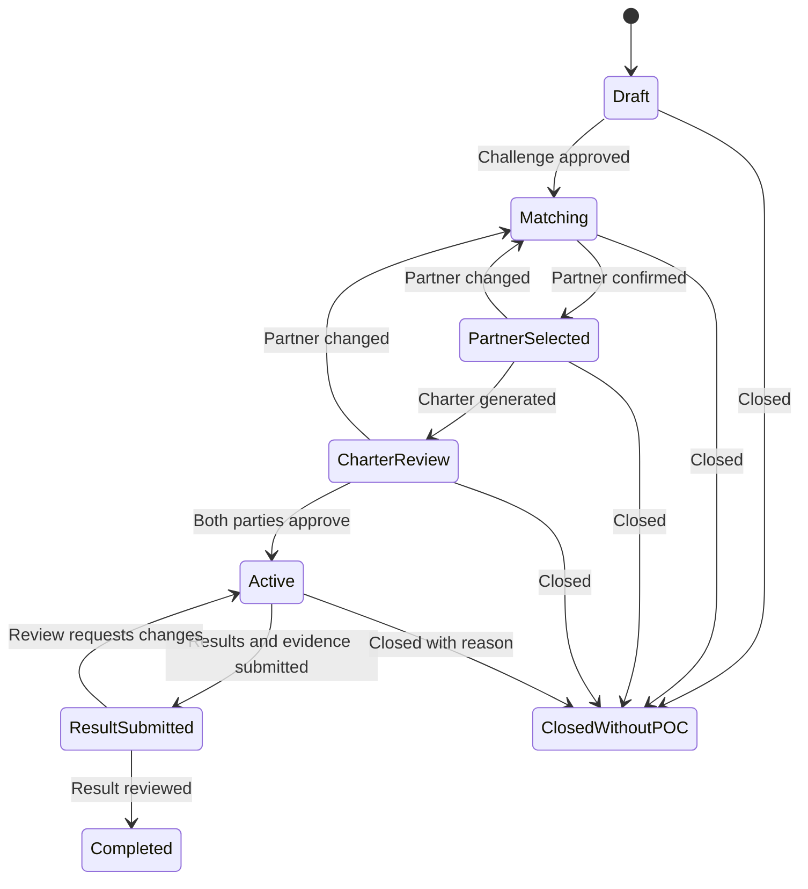

# PilotBridge ASEAN — Masterplan

## 1. Product Definition

**One-line pitch:** PilotBridge turns corporate challenges into explainable startup matches, structured cross-border proof-of-concept projects (POCs), and evidence-backed commercial outcomes.

**Problem statement:** How can Startup ASEAN successfully convert ecosystem connections into measurable outcomes, including investments, commercial partnerships, market expansion, and cross-border POCs?

**Primary outcome:** Cross-border POCs initiated, completed, measured, and converted into commercial next steps.

**Product principle:** Every introduction must end with a clear next action, responsible owner, deadline, and measurable outcome.

PilotBridge is an execution copilot, not another ecosystem directory. AI helps structure information and draft documents; deterministic application logic controls matching eligibility, pipeline transitions, locks, health status, and reported metrics.

---

## 2. Users and Jobs

| User | Primary job |
|---|---|
| Corporate innovation lead | Convert an operational problem into a scoped pilot with measurable success criteria. |
| Startup founder | Discover relevant challenges, demonstrate fit, and execute a cross-border POC. |
| Startup ASEAN programme manager | Facilitate introductions, unblock stalled POCs, and report verified ecosystem outcomes. |

### MVP roles

- **Corporate user:** creates and owns challenges; confirms charter and results.
- **Startup user:** maintains capability profile; responds to matches and executes assigned actions.
- **Programme manager:** views all demo POCs, facilitates next steps, and reviews outcomes.

A lightweight demo role switcher is sufficient. Production-grade identity and permissions are outside the MVP.

---

## 3. Core Product Loop

```mermaid
flowchart LR
    A[Corporate submits challenge] --> B[AI structures requirements]
    B --> C[Top 3 startups matched]
    C --> D[POC partner confirmed]
    D --> E[POC charter generated]
    E --> F[Milestones and actions tracked]
    F --> G[Results backed by evidence]
    G --> H[Completed POC or commercial partnership]
    H --> I[Startup ASEAN outcome dashboard]
```

The MVP must demonstrate this loop end to end. Individual AI outputs without a state-changing workflow do not satisfy the product goal.

---

## 4. Scope

### Must have

1. Structured challenge creation.
2. Curated startup profiles.
3. Explainable top-three matching.
4. Locked-context partner selection.
5. Warm-introduction pack.
6. POC charter generation and editing.
7. Meeting-notes-to-action conversion.
8. Milestones, actions, evidence, and deterministic health rules.
9. Result card generation.
10. Ecosystem outcomes dashboard.

### Optional if the complete core loop is already working

- PDF export for charters and result cards.
- Evidence file uploads instead of evidence links and text references.
- Detailed activity-history timeline.
- Additional demo challenges and countries.

### Explicitly excluded from the MVP

- Public startup marketplace or full ASEAN coverage.
- Automated email, calendar, CRM, or messaging integrations.
- Video calls, payments, and contract signing.
- Complex organisation permissions.
- Investment recommendations or predictions.
- Predictive probability of POC success.
- Automated commercial-value verification.

---

## 5. Feature Specifications

### 5.1 AI Challenge Structurer

**Input:** Plain-language problem statement, optionally accompanied by a PDF or relevant image.

**AI-generated draft fields:**

- Business problem and desired outcome.
- Required startup capabilities.
- Operational and technical constraints.
- Available data and systems.
- Target country and deployment site.
- Indicative budget and timeline.
- Baseline, target, measurement method, and success metrics.
- Missing information and clarification questions.

**Example transformation:**

> “We want to reduce delivery delays using AI.”

Becomes:

> “Reduce late deliveries at our Singapore distribution centre from an 11% baseline to below 7% during a 12-week pilot, using existing order and vehicle-location data.”

The corporate user must review and approve the structured challenge before matching begins. Unsupported values must be marked as missing rather than invented.

### 5.2 Explainable Top-Three Matching

Compare curated startup profiles against approved requirements using:

- Capability alignment.
- Industry experience.
- Product maturity.
- Target-country presence.
- Deployment requirements.
- Language and implementation support.
- Capacity for the proposed timeline.

Each recommendation displays:

- Match reasons with references to profile evidence.
- Missing evidence.
- Risks and potential deal-breakers.
- Questions for the first meeting.
- Criterion-level fit indicators.

Do not present an unexplained score such as “94% match.” If a numeric rank is used, its calculation must be visible and reproducible.

### 5.3 Locked-Context Assignment Modal

Adapt the supplied room-assignment reference into **Change POC Partner**. The useful pattern is locked context plus explicit eligible and ineligible choices—not its visual domain or wording.

**Content:**

- Title: `Change POC Partner`.
- Subtitle: `1 challenge · Last-Mile Delivery Optimisation`.
- Locked field: corporate challenge.
- Candidate list with availability and reason labels.
- Optional `Reset selection` before confirmation.
- Actions: `Cancel` and `Confirm Partner`.

**Candidate states:**

| State | Appearance and behaviour |
|---|---|
| Available | Selectable; displays concise fit reason. |
| Selected | Clearly highlighted; persists until saved or cancelled. |
| In active POC | Disabled; explains why. |
| Conflict identified | Disabled; identifies the conflict. |
| Missing critical information | Selectable only if policy permits; warning remains visible. |

**Locking rules:**

| POC state | Partner change |
|---|---|
| Draft | Allowed. |
| Matching | Allowed. |
| Partner selected | Allowed with explicit confirmation. |
| Charter review | Allowed only through revision; prior charter is invalidated. |
| Active | Locked. |
| Completed or cancelled | Locked. |

Changing the partner before activation records the previous selection in activity history and regenerates the charter. An active POC cannot silently replace its startup; it must be revised or closed and replaced according to an explicit workflow.

### 5.4 Warm-Introduction Pack

After partner confirmation, generate:

- Introduction email.
- One-page startup summary.
- Corporate challenge brief.
- Shared meeting objective.
- Three technical or commercial questions.
- Proposed next step.

Use copy and download actions; no email integration is required.

### 5.5 One-Click POC Charter

Generate an editable charter containing:

- Corporate and startup participants.
- Corporate sponsor and delivery owners.
- Problem statement and pilot scope.
- Explicit out-of-scope items.
- Duration and milestones.
- Required data, systems, and personnel.
- Cross-border responsibilities.
- Baseline, target, and measurement method.
- Budget or commercial assumptions.
- Exit conditions.
- Post-POC decision date.

AI drafts the charter. Both parties must review and approve the final content before activation. Material charter changes after approval create a new revision.

### 5.6 Meeting-to-Action Converter

The user pastes meeting notes. AI proposes:

- Decisions.
- Action items.
- Responsible owners.
- Due dates.
- Requested documents.
- Unresolved issues.
- Proposed next milestone.

Display an editable review screen before saving. Dates and owners that cannot be inferred remain unassigned. The model must not fabricate attendance, decisions, or commitments.

### 5.7 Cross-Border Readiness Checklist

Attach a short checklist to each POC:

- Corporate decision-maker assigned.
- Local implementation owner assigned.
- Data access and residency questions resolved.
- Procurement path identified.
- Language requirements identified.
- Regulatory review required or explicitly not applicable.

Checklist completion is informational unless a specific charter requirement makes it a gate.

### 5.8 Milestones and POC Health

Each milestone and action has an owner, due date, status, and optional supporting evidence.

Use deterministic health rules evaluated against the current date:

| Health | Rule |
|---|---|
| On Track | Active POC with no overdue critical milestone or decision. |
| At Risk | At least one critical milestone or decision is overdue. |
| Stalled | No recorded meaningful activity for 14 days, or a critical milestone is more than 7 days overdue. |
| Completed | Required result fields and evidence are submitted and reviewed. |
| Closed Without POC | Parties chose not to proceed; closure reason is recorded. |

**Precedence:** Completed/Closed → Stalled → At Risk → On Track. Only active POCs receive operational health states.

Add a **Next Best Action** panel derived from the current state:

> “The data owner has not been assigned. Assign one before the technical workshop.”

AI may explain a status or draft a follow-up, but it does not determine health.

### 5.9 Evidence-Based Result Card

At completion, capture:

- Baseline.
- Original target.
- Actual result.
- Unit and measurement period.
- Evidence reference or attachment.
- Participant testimonial.
- Commercial decision.

Generate a one-page result card suitable for Startup ASEAN reporting.

**Example:**

> Delivery delays decreased from 11% to 6.8% during the 12-week POC, exceeding the 7% target. Both parties approved commercial negotiation.

### 5.10 Ecosystem Outcomes Dashboard

Display:

- Challenges published.
- Introductions accepted.
- POCs approved and completed.
- Introduction-to-POC conversion rate.
- Median time from challenge to approval.
- Active POCs at risk or stalled.
- POCs entering commercial negotiation.
- Signed commercial partnerships.
- Participating country pairs.

Separate verified results from self-reported outcomes. Never count introductions, projected contract values, or expressed investor interest as realised impact.

---

## 6. Screens and User Flows

### 6.1 Challenges Dashboard

- List challenges and their current stages.
- Show match count, next action, owner, and POC health.
- Provide `Create Challenge` as the primary action.

### 6.2 Challenge Detail

- Display approved requirements and missing information.
- Show top-three recommendations.
- Open partner-selection modal.
- Show selected partner and introduction-pack actions.

### 6.3 Match and Confirm Partner

- Compare recommendations by criteria.
- Inspect reasons, evidence gaps, and risks.
- Select an eligible startup and explicitly confirm.

### 6.4 POC Workspace

Use tabs or anchored sections for:

- Overview and next best action.
- Charter and revisions.
- Milestones and actions.
- Meeting-note conversion.
- Cross-border readiness.
- Evidence and result card.
- Activity history.

### 6.5 Ecosystem Outcomes Dashboard

- Show conversion funnel, operational health, country pairs, and commercial progression.
- Label demo data clearly.
- Provide definitions or tooltips for every metric.

---

## 7. State Model

### 7.1 POC pipeline

### 7.2 Commercial progression

Track separately from technical POC status:

**No Decision → Commercial Negotiation → Contract Signed / Not Proceeding**

A technically successful POC does not automatically imply a commercial contract. Signed status requires an explicit confirmation and evidence reference.

---

## 8. Minimum Data Model

| Entity | Essential fields |
|---|---|
| Organisation | ID, name, type, country, sector |
| User | ID, organisation ID, role, name |
| Challenge | ID, corporate ID, requirements, constraints, baseline, target, unit, status |
| StartupProfile | ID, organisation ID, capabilities, maturity, markets, capacity, availability |
| Match | ID, challenge ID, startup ID, criterion results, reasons, risks, rank |
| POC | ID, challenge ID, startup ID, status, health, dates, current revision |
| CharterRevision | ID, POC ID, content, revision number, approval states |
| Milestone | ID, POC ID, title, owner ID, due date, critical flag, status |
| Action | ID, POC ID, title, owner ID, due date, status, source |
| Evidence | ID, POC ID, type, reference, verification status |
| Result | ID, POC ID, baseline, target, actual, unit, period, review status |
| CommercialOutcome | ID, POC ID, stage, value, currency, evidence, verification status |
| ActivityEvent | ID, POC ID, actor, event type, timestamp, metadata |

Use stable IDs and timestamps for every entity. Monetary value is optional and must remain unverified until supported by evidence.

---

## 9. Gemma 4 and Application Architecture

### 9.1 AI responsibilities

Use Gemma 4 through the Gemini API for:

- Extracting requirements from challenge text, PDFs, and images.
- Reading pitch decks and product screenshots.
- Producing evidence-grounded match explanations.
- Drafting introduction packs and POC charters.
- Converting meeting notes into proposed actions.
- Generating result-card narratives.

### 9.2 Deterministic application responsibilities

Keep these outside the model:

- Eligibility restrictions and availability.
- Partner locking after activation.
- Pipeline transitions and permissions.
- Due-date and overdue calculations.
- POC health rules.
- Commercial-stage validation.
- Aggregate dashboard metrics.

### 9.3 AI output contract

Every AI feature must:

1. Send only the minimum required source content.
2. Request a versioned JSON schema.
3. Validate the response before rendering or saving.
4. Preserve missing values as `null`; prohibit invented evidence.
5. Include source references where claims depend on supplied documents.
6. Show generated content as a draft requiring user review.
7. Handle malformed responses with a retry or clear error, not partial silent saves.

### 9.4 Suggested implementation shape

- Responsive web application.
- Server-side API routes for Gemini calls and workflow mutations.
- Persistent relational database for challenges, POC state, and outcomes.
- Small curated seed dataset.
- Centralised state-transition and health-rule functions.
- API key stored only in server environment configuration.

Framework choice should follow the team's fastest maintained stack; it does not affect product qualification.

---

## 10. Demo Dataset

Use one corporate challenge and five fictional startups. Mark all data as fictional.

| Entry | Demo purpose |
|---|---|
| Singapore logistics corporate | Needs late deliveries reduced from 11% to below 7%. |
| Startup A | Strong route-optimisation fit; available. |
| Startup B | Relevant technology; already in an active POC and disabled. |
| Startup C | Strong product; lacks required data integration. |
| Startup D | Good regional support; limited logistics experience. |
| Startup E | Relevant computer-vision product; poor capability fit. |

This dataset demonstrates matching, unavailable choices, missing evidence, cross-border responsibilities, and outcome reporting without requiring a large directory.

---

## 11. Winning Demo Script

1. Create the corporate challenge in plain language.
2. Show Gemma structuring the requirements and success target.
3. Display three ranked matches with reasons and risks.
4. Open **Change POC Partner**.
5. Show the locked challenge, available candidates, and disabled unavailable candidate.
6. Confirm a partner and generate the introduction pack and POC charter.
7. Paste meeting notes and review extracted actions before saving.
8. Make a critical action overdue; show the POC changing to **At Risk** or **Stalled** according to the rules.
9. Display the recommended next action.
10. Submit a measured result and evidence reference.
11. Generate the result card and move commercial progression to negotiation.
12. Update the ecosystem outcomes dashboard.

**Demo narrative:** PilotBridge moved a cross-border connection into a measured POC and a commercial next step. The story is not merely that AI matched two organisations.

---

## 12. Delivery Sequence

### Phase 1 — Workflow foundation

- Seed organisations, challenge, and startup profiles.
- Implement challenge creation and persistent POC state.
- Implement pipeline transitions and dashboard queries.
- Build the five core screens with non-AI fallback content.

### Phase 2 — Matching and assignment

- Implement criterion-based matching.
- Add explanations, evidence gaps, and risks.
- Build locked-context assignment with disabled states and history.

### Phase 3 — AI execution copilot

- Add challenge structuring with validated JSON.
- Add introduction-pack and charter generation.
- Add meeting-note extraction and editable review.
- Add result-card generation.

### Phase 4 — Outcomes and polish

- Complete milestone and action tracking.
- Verify health precedence and date boundaries.
- Add evidence review and separate commercial progression.
- Verify dashboard calculations and demo narrative.

### Cut line

If schedule pressure occurs, reduce visual polish and optional exports. Do not cut partner confirmation, charter approval, milestone tracking, measured results, or dashboard updates: those form the required connection-to-outcome loop.

---

## 13. Verification Checklist

### Functional

- [ ] A challenge cannot enter matching until approved.
- [ ] AI extraction leaves unknown values missing.
- [ ] Only eligible startups can be selected.
- [ ] Cancelling the assignment modal preserves the current partner.
- [ ] Partner change invalidates an unapproved charter and records history.
- [ ] Active and completed POCs reject partner changes.
- [ ] Generated actions remain unsaved until reviewed.
- [ ] POC activation requires the defined approvals.
- [ ] Result submission requires baseline, target, actual, unit, and evidence.
- [ ] Commercial signing is tracked independently of POC completion.

### Health and metrics

- [ ] Health uses the stated precedence and current date.
- [ ] Completed and closed POCs do not appear as active operational risks.
- [ ] Conversion-rate denominator and numerator are defined consistently.
- [ ] Median approval time handles empty datasets.
- [ ] Signed value is excluded when no signed outcome exists.
- [ ] Verified and self-reported outcomes are visually distinct.

### AI quality

- [ ] Every generated claim is grounded in supplied data or labelled as a suggestion.
- [ ] Invalid JSON is rejected safely.
- [ ] API failure does not corrupt saved workflow state.
- [ ] Users can edit all generated drafts.
- [ ] No confidential content appears in the aggregate dashboard.

### Demo

- [ ] The complete demo runs using seeded fictional data.
- [ ] A fresh reset reproduces the same initial state.
- [ ] The core flow remains understandable without presenter explanation.
- [ ] The final dashboard visibly changes after the completed POC.

---

## 14. Pitch Structure

1. **Problem:** Ecosystem introductions disappear into chats and spreadsheets, with little evidence of resulting POCs or partnerships.
2. **Solution:** PilotBridge provides one execution path from corporate challenge to measured cross-border POC.
3. **Demo:** Show the complete workflow, not isolated model calls.
4. **AI value:** Gemma 4 interprets multimodal source material and turns it into structured, actionable drafts.
5. **Trust:** Eligibility, locks, health, and metrics are deterministic; evidence and human approval govern outcomes.
6. **Impact:** Startup ASEAN can see where POCs stall, intervene earlier, and report verified results.
7. **Vision:** Expand the same outcome infrastructure to investment readiness and market-entry partnerships after proving POC execution.

---

## 15. Success Criteria for the Prototype

The prototype is successful when a new user can:

1. Turn a vague corporate problem into a measurable challenge.
2. Understand why each startup was recommended.
3. Confirm an eligible partner without violating workflow locks.
4. Generate and approve a concrete POC charter.
5. Identify the next responsible action when execution stalls.
6. Submit a result supported by evidence.
7. Observe the completed POC and commercial next step in Startup ASEAN's dashboard.

That complete journey is the product's differentiator and the primary measure of implementation completeness.
