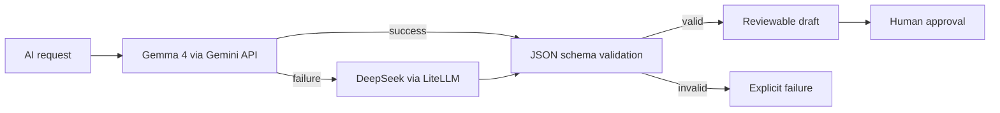
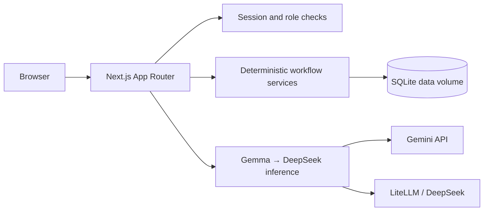

# PilotBridge ASEAN

**From a corporate problem to a measured, evidence-backed cross-border POC.**

PilotBridge is an execution copilot for Startup ASEAN. It turns unstructured corporate challenges into explainable startup matches, jointly approved proof-of-concept projects, and verified commercial outcomes.

Live: **https://pilotbridge.nusabyte.cloud**

> All seeded organisations, people, challenges, metrics, and outcomes are fictional demonstration data.

---

## Why PilotBridge

Ecosystem platforms stop at the introduction. PilotBridge asks the harder question:

> **Did this connection produce a verified POC and a real commercial next step?**

Every introduction must end with a named partner, a bounded pilot, an owner, a deadline, and a measurable result.

### Unique selling points

| USP | What it means in practice |
|---|---|
| **Connection → outcome, not a directory** | The product covers challenge, matching, partner confirmation, charter, execution, evidence, completion, and commercial progression in one workflow. |
| **Explainable, deterministic matching** | Scores are reproducible from visible criteria. AI may explain a match but can never change eligibility, rank, or lock state. |
| **AI drafts, the application owns truth** | Eligibility, partner locks, pipeline transitions, charter approvals, POC health, and reported metrics are deterministic code. |
| **Evidence before impact** | Completion requires baseline, target, actual, unit, period, and an evidence reference. Projections and investor interest are never counted as realised outcomes. |
| **Commercial success tracked separately** | A technically successful POC never implies a contract. Signed status needs a value, currency, and evidence. |
| **Gemma-first multimodal inference** | Gemma 4 reads text, PDFs, and images. DeepSeek is an automatic fallback for text-only tasks. |
| **One-click demo, secured workspace** | Signed, HTTP-only sessions, role enforcement, and a rate-limited demo entry for evaluation. |

---

## Demo access

### One-click demo

1. Open **https://pilotbridge.nusabyte.cloud/login**
2. Select **Enter one-click demo**
3. Full programme-manager access to fictional data for one hour.

The demo entry is controlled by `PILOTBRIDGE_DEMO_LOGIN=true`, issues a one-hour session, and is rate-limited to five sessions per minute per IP.

### Demo account

| Field | Value |
|---|---|
| Email | `demo@pilotbridge.demo` |
| Password | `PilotBridge-Demo-2026!` |
| Role | Programme manager |

Change this password before public promotion. Create additional accounts with:

```bash
node scripts/create-account.mjs <email> <password-12+> [role]
```

Roles: `Programme manager`, `Corporate`, `Startup`.

---

## How to use the product

### 1. Create and structure a challenge

- Open **Challenges → Create challenge**.
- Enter a problem statement or upload a PDF/image brief.
- Gemma drafts requirements, capabilities, constraints, baseline, target, and missing information.
- Unknown values stay `null`; nothing enters matching until you approve the structured challenge.

### 2. Review explainable matches

- Open the challenge detail.
- Inspect the deterministic top three, criterion scores, reasons, risks, and evidence gaps.
- Optionally generate grounded first-meeting questions.
- Select **Compare & select partner**, choose an eligible startup, and confirm.

### 3. Approve the charter

- Generate the warm-introduction pack and POC charter.
- Edit the charter if needed; edits reset both approvals.
- Corporate and startup each approve; then activate the POC.

### 4. Execute and measure

- Convert meeting notes into reviewed actions, decisions, documents, and unresolved issues.
- Track milestones and owners. POC health is deterministic.
- Submit baseline, target, actual result, unit, period, and evidence.
- A reviewer verifies the result or returns it for changes.

### 5. Record commercial progression

```text
No Decision → Commercial Negotiation → Contract Signed / Not Proceeding
```

Contract signing requires an explicit value, currency, and evidence reference. It is independent of technical completion.

### 6. Use the marketplace

- Browse startup and investor profiles.
- Compare investor alignment across sector, stage, geography, ticket, and POC readiness.
- Create a first-phase POC idea with a 12-week proof plan.
- Convert an eligible idea into a separate draft challenge and charter.

---

## POC pipeline

```text
Draft → Matching → Partner Selected → Charter Review → Active → Result Submitted → Completed
```

| Rule | Behavior |
|---|---|
| Challenge approval | Required before matching |
| Partner eligibility | Unavailable startups disabled; server rechecks |
| Partner lock | Locked after activation |
| Charter approval | Both parties required; edits reset approvals |
| Result submission | Measurements and evidence required |
| Result review | Verify → Completed, or request changes → Active |
| Health precedence | `Completed` → `Stalled` → `At Risk` → `On Track` |

---

## Inference architecture



- **Primary:** Gemma 4 (`gemma-4-31b-it`, or `gemma-4-26b-a4b-it`), multimodal for text, PDFs, and images.
- **Fallback:** DeepSeek `deepseek-v4.1-flash` for text-only generation when Gemma fails.
- **Multimodal rule:** document extraction requires Gemma; it does not silently degrade to a text-only model.
- **Validation:** every response is parsed against a versioned Zod schema.
- **Audit:** provider, model, prompt version, schema version, SHA-256 input digest, attempts, status, and latency are recorded.
- **Key safety:** API keys remain server-side. Audit records a one-way key fingerprint, never the key.

### Provider configuration

```env
GEMINI_API_KEY=...
GEMMA_MODEL=gemma-4-31b-it
LITELLM_API_KEY=...
LITELLM_BASE_URL=https://litellm.rapidscreen.io/v1
LITELLM_MODEL=deepseek-v4.1-flash
```

Without either key, the app returns an explicitly labelled deterministic demo draft.

---

## Screens

| Route | Purpose |
|---|---|
| `/` | Public marketing landing |
| `/login` | Secure sign-in and one-click demo |
| `/app` | Challenges dashboard |
| `/app/challenges/[id]` | Requirements, matches, partner selection |
| `/app/poc?id=[pocId]` | POC workspace: overview, charter, execution, results |
| `/app/outcomes` | Funnel, health, verified impact, country pairs, signed partnerships |
| `/app/marketplace` | Startup and investor discovery |
| `/app/marketplace/profile/[id]` | Editable startup profile |
| `/app/marketplace/ideas/[id]` | First-phase POC ideation and conversion |

---

## Security model

- Signed HMAC-SHA256 sessions, HTTP-only and `Secure` in production
- scrypt password hashing with per-user salt
- Session-version revocation after password change
- Middleware route protection plus independent role checks in the mutation API
- Login and AI endpoints rate-limited per IP and operation
- 12 MiB request cap; PDF/PNG/JPEG/WebP upload allowlist, 10 MiB each
- Server-only provider and database credentials
- Credentials persisted in the data volume with owner-only permissions

Production boundary: the current database is SQLite inside a Docker volume. Use PostgreSQL, managed object storage, and an external identity provider before handling confidential corporate data. See `TECHNICAL_ARCHITECTURE.md` and `deploy/AUTH.md`.

---

## Architecture



- Next.js 16 App Router, React 19, TypeScript strict
- Tailwind CSS 4 plus a custom hairline workspace design system
- Zod validation at API and AI boundaries
- Vitest for deterministic and security rules
- Docker standalone deployment behind nginx with Let's Encrypt TLS

---

## Local development

Requirements: Node.js 22+, pnpm 10+.

```bash
pnpm install
cp .env.example .env.local
pnpm dev
```

Open <http://localhost:3000>. Data is created at `data/pilotbridge.db`.

For local evaluation without auth:

```env
PILOTBRIDGE_DEMO=true
```

`PILOTBRIDGE_DEMO=true` disables login checks. Never use it with real data.

### Quality checks

```bash
pnpm lint
pnpm typecheck
pnpm test
pnpm build
```

### Create an account

```bash
node scripts/create-account.mjs demo@example.com 'A-strong-password-2026!' 'Programme manager'
```

---

## Deployment

Production runs as a Docker container on the Hostinger VPS behind nginx.

```bash
scp -r src public scripts ecta-vps:/opt/pilotbridge/
ssh ecta-vps "cd /opt/pilotbridge && docker compose -f docker-compose.production.yml up -d --build"
```

Operational runbooks:

- `deploy/README.md` — deployment, health, backup
- `deploy/AUTH.md` — authentication and roles
- `deploy/AGENTS.md` — multi-agent inference and credential handling

Health check:

```bash
curl -fsS https://pilotbridge.nusabyte.cloud/api/health
```

---

## Verified browser path

1. Public landing → login
2. One-click demo session
3. Challenge creation and AI structuring
4. Human approval and explainable top-three matching
5. Partner confirmation and joint charter approval
6. Activation, meeting actions, deterministic health transition
7. Result submission, review rejection, resubmission, verification
8. Commercial negotiation and evidence-backed contract signing
9. Marketplace profile → investor matching → POC ideation → draft charter
10. Aggregate outcomes dashboard

---

## Repository

<https://github.com/nusabyte-my/pilot-bridge.git>

## Licence

See `LICENSE`.
