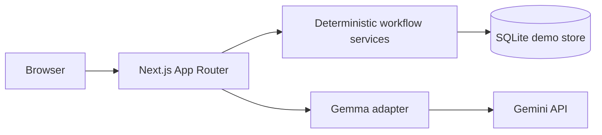

# PilotBridge ASEAN

**From a corporate problem to a measured, evidence-backed cross-border POC.**

PilotBridge is an execution copilot for Startup ASEAN. It turns unstructured corporate challenges into explainable startup matches, structured proof-of-concept projects, and verified commercial outcomes. AI drafts; deterministic application logic owns eligibility, locking, health, and reported metrics.

> All seeded organisations, people, challenges, metrics, and outcomes are fictional demonstration data.

## Product thesis

Ecosystem introductions usually disappear into chats and spreadsheets. PilotBridge makes every introduction end with a named partner, a bounded pilot, an owner, a deadline, and a measurable result. The product is designed around one question:

> Did this connection produce a verified POC and a real commercial next step?

## Core workflow

```mermaid
flowchart LR
    A[Challenge created] --> B[Gemma structures requirements]
    B --> C[Human review and approval]
    C --> D[Top-three explainable matches]
    D --> E[Eligible partner confirmed]
    E --> F[Introduction pack and POC charter]
    F --> G[Both parties approve]
    G --> H[Milestones, actions and evidence]
    H --> I[Measured result reviewed]
    I --> J[Commercial decision, tracked separately]
```



## Screens

| Route | Purpose |
|---|---|
| `/` | Challenges dashboard: every challenge, partner, stage, health, and next action |
| `/challenges/[id]` | Challenge detail: approved requirements, gaps, top-three matches, partner selection |
| `/poc?id=[pocId]` | POC workspace: overview, charter, execution, health, evidence, results, commercial outcome |
| `/outcomes` | Ecosystem dashboard: funnel, all POC health, verified impact, country pairs, signed partnerships |
| `/marketplace` | Startup and investor discovery with explainable investor matching |
| `/marketplace/profile/[id]` | Editable startup profile and capability evidence |
| `/marketplace/ideas/[id]` | First-phase POC ideation with 12-week proof plan and conversion to draft charter |

## POC pipeline

```text
Draft → Matching → Partner Selected → Charter Review → Active → Result Submitted → Completed
```

Implemented rules:

- A challenge cannot enter matching until its structured requirements are approved.
- Partner confirmation is blocked for unavailable startups and locked after activation.
- Charter edits reset both approvals. Activation requires both parties.
- Result submission requires baseline, target, actual, unit, measurement period, and evidence.
- A reviewer can verify and complete, or return the result to **Active** for changes.
- POC health uses deterministic precedence: `Completed` → `Stalled` → `At Risk` → `On Track`.

## Commercial progression

Tracked independently from technical POC success:

```text
No Decision → Commercial Negotiation → Contract Signed / Not Proceeding
```

- Technical success never implies commercial success.
- **Contract Signed** requires an explicit value, currency, and evidence reference.
- **Contract Signed** and **Not Proceeding** are terminal states.
- Commercial metrics are excluded from verified impact until explicitly recorded.

## Matchmaking

Two distinct engines keep the product honest:

1. **Corporate challenge → startup** (`src/lib/matching.ts`) uses capability, industry, maturity, deployment, and availability. Scores are reproducible and displayed with reasons and evidence gaps.
2. **Startup → investor** (`src/lib/marketplace-matching.ts`) adapts ALAND’s explainable weighted-matching architecture: sector thesis, stage, geography, ticket fit, and POC readiness, plus trust multipliers and hard eligibility gates.

Investor matching ranks **thesis and pilot readiness**, not investment probability. It never presents a funding prediction.

## Gemma 4 integration

Gemma is used through the Gemini API for:

- Structured challenge extraction from text, PDFs, and images
- Meeting notes to proposed actions
- Result-card narrative drafting

Every AI path follows the same contract:

- Server-side API key only
- Versioned JSON schema and Zod validation
- Unknown values remain `null`
- Source references preserved
- Draft content requires human review
- Malformed output or provider failure cannot mutate workflow state

Without `GEMINI_API_KEY`, the application uses an explicitly labelled offline demo extraction path. It does not pretend to be a live model response.

## Architecture



- **Framework:** Next.js 16 App Router, React 19, TypeScript strict
- **UI:** custom hairline design system; accessible labels, focus states, keyboard modal handling, mobile layouts
- **Validation:** Zod at API and AI boundaries
- **Persistence:** transactional SQLite for the self-contained hackathon demo
- **AI:** `@google/genai` with JSON-schema responses
- **Tests:** Vitest for deterministic rules
- **Production path:** PostgreSQL, managed identity, private object storage, and queueing are specified in `TECHNICAL_ARCHITECTURE.md`

## Data model

The demo persists:

- Organisations, users, challenges, startup profiles, investors
- Explainable match records with criteria, reasons, risks, and rank
- POCs with lifecycle timestamps and health
- Charter approvals, milestones, actions, readiness items
- Evidence, measured results, and verified commercial outcomes
- Append-only activity events
- POC ideas and introduction requests

## Run locally

Requirements: Node.js 22+, pnpm 10+.

```bash
pnpm install
pnpm dev
```

Open <http://localhost:3000>. The database is created at `data/pilotbridge.db` with fictional seed data.

### Live Gemma configuration

```bash
cp .env.example .env.local
```

```env
GEMINI_API_KEY=your_key
GEMINI_MODEL=gemma-4-27b-it
PILOTBRIDGE_DB=./data/pilotbridge.db
```

Confirm the exact model identifier available to your API key.

## Quality checks

```bash
pnpm lint
pnpm typecheck
pnpm test
pnpm build
```

Verified browser path:

1. Challenge creation and AI structuring
2. Human review and approval
3. Explainable top-three matching
4. Partner confirmation
5. Joint charter approval and activation
6. Meeting notes → reviewed actions
7. Deterministic health transition
8. Result submission → review rejection → resubmission
9. Evidence verification and completion
10. Commercial negotiation → evidence-backed contract signing
11. Terminal-state rejection
12. Marketplace profile edit → investor matching → POC ideation → draft charter conversion

## Demo reset

Use **Reset demo** on the Outcomes page to restore the fictional seed state. This is a demo operation, not a production recovery mechanism.

## Security and demo boundary

- No production authentication is implemented. Do not use real confidential corporate data.
- AI and database credentials remain server-side.
- Uploads are limited to PDF/PNG/JPEG/WebP and 10 MiB.
- Generated content is never auto-approved.
- Production requirements—OIDC authentication, tenant authorization, retention policy, private evidence storage, rate limits, and restore testing—are documented in `TECHNICAL_ARCHITECTURE.md`.

## Repository

<https://github.com/nusabyte-my/pilot-bridge.git>

## License

Hackathon prototype. Add a license before commercial distribution.
