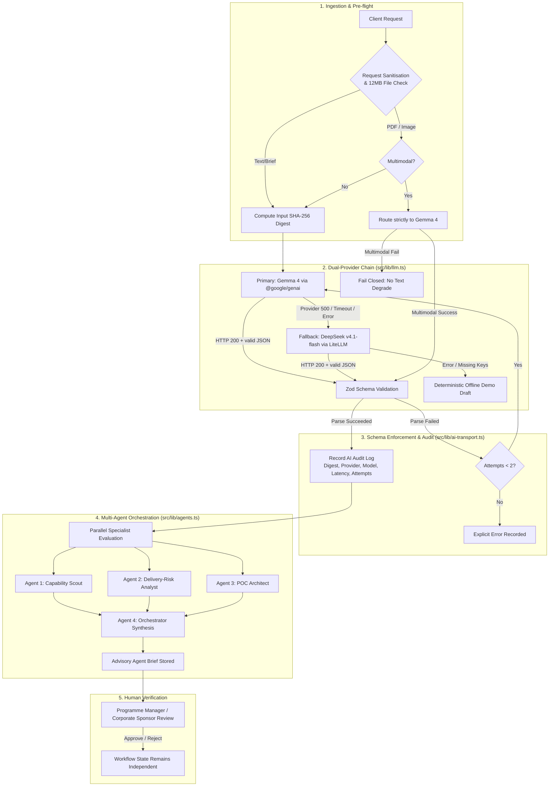
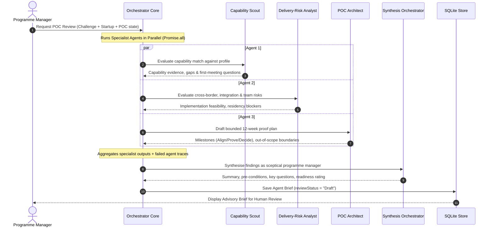
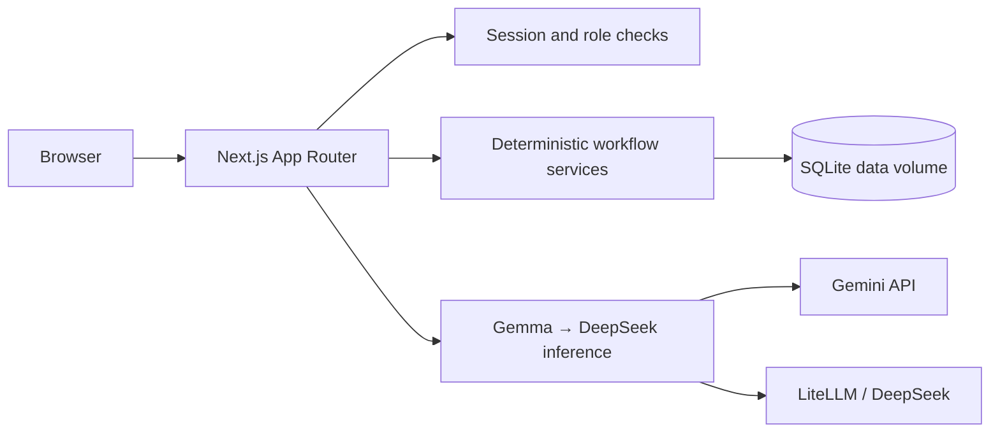

# PilotBridge ASEAN

**From a corporate problem to a measured, evidence-backed cross-border POC.**

PilotBridge is an execution copilot for Startup ASEAN. It turns unstructured corporate challenges into explainable startup matches, jointly approved proof-of-concept projects, and verified commercial outcomes.

Live: **https://pilotbridge.nusabyte.cloud**

> All seeded organisations, people, challenges, metrics, and outcomes are fictional demonstration data.

---

## Why PilotBridge

Ecosystem platforms stop at the introduction. PilotBridge asks the harder question:

> **Did this connection produce a verified POC and a real commercial next step?**

Every introduction must end with a named partner, a bounded pilot, an owner, a deadline, and a measurable result.

### Unique selling points

| USP | What it means in practice |
|---|---|
| **Connection → outcome, not a directory** | The product covers challenge, matching, partner confirmation, charter, execution, evidence, completion, and commercial progression in one workflow. |
| **Explainable, deterministic matching** | Scores are reproducible from visible criteria. AI may explain a match but can never change eligibility, rank, or lock state. |
| **AI drafts, the application owns truth** | Eligibility, partner locks, pipeline transitions, charter approvals, POC health, and reported metrics are deterministic code. |
| **Evidence before impact** | Completion requires baseline, target, actual, unit, period, and an evidence reference. Projections and investor interest are never counted as realised outcomes. |
| **Commercial success tracked separately** | A technically successful POC never implies a contract. Signed status needs a value, currency, and evidence. |
| **Gemma-first multimodal inference** | Gemma 4 reads text, PDFs, and images. DeepSeek is an automatic fallback for text-only tasks. |
| **One-click demo, secured workspace** | Signed, HTTP-only sessions, role enforcement, and a rate-limited demo entry for evaluation. |

---

## Demo access

### One-click demo

1. Open **https://pilotbridge.nusabyte.cloud/login**
2. Select **Enter one-click demo**
3. Full programme-manager access to fictional data for one hour.

The demo entry is controlled by `PILOTBRIDGE_DEMO_LOGIN=true`, issues a one-hour session, and is rate-limited to five sessions per minute per IP.

### Demo account

| Field | Value |
|---|---|
| Email | `demo@pilotbridge.demo` |
| Password | `PilotBridge-Demo-2026!` |
| Role | Programme manager |

Change this password before public promotion. Create additional accounts with:

```bash
node scripts/create-account.mjs <email> <password-12+> [role]
```

Roles: `Programme manager`, `Corporate`, `Startup`.

---

## How to use the product

### 1. Create and structure a challenge

- Open **Challenges → Create challenge**.
- Enter a problem statement or upload a PDF/image brief.
- Gemma drafts requirements, capabilities, constraints, baseline, target, and missing information.
- Unknown values stay `null`; nothing enters matching until you approve the structured challenge.

### 2. Review explainable matches

- Open the challenge detail.
- Inspect the deterministic top three, criterion scores, reasons, risks, and evidence gaps.
- Optionally generate grounded first-meeting questions.
- Select **Compare & select partner**, choose an eligible startup, and confirm.

### 3. Approve the charter

- Generate the warm-introduction pack and POC charter.
- Edit the charter if needed; edits reset both approvals.
- Corporate and startup each approve; then activate the POC.

### 4. Execute and measure

- Convert meeting notes into reviewed actions, decisions, documents, and unresolved issues.
- Track milestones and owners. POC health is deterministic.
- Submit baseline, target, actual result, unit, period, and evidence.
- A reviewer verifies the result or returns it for changes.

### 5. Record commercial progression

```text
No Decision → Commercial Negotiation → Contract Signed / Not Proceeding
```

Contract signing requires an explicit value, currency, and evidence reference. It is independent of technical completion.

### 6. Use the marketplace

- Browse startup and investor profiles.
- Compare investor alignment across sector, stage, geography, ticket, and POC readiness.
- Create a first-phase POC idea with a 12-week proof plan.
- Convert an eligible idea into a separate draft challenge and charter.

---

## POC pipeline

```text
Draft → Matching → Partner Selected → Charter Review → Active → Result Submitted → Completed
```

| Rule | Behavior |
|---|---|
| Challenge approval | Required before matching |
| Partner eligibility | Unavailable startups disabled; server rechecks |
| Partner lock | Locked after activation |
| Charter approval | Both parties required; edits reset approvals |
| Result submission | Measurements and evidence required |
| Result review | Verify → Completed, or request changes → Active |
| Health precedence | `Completed` → `Stalled` → `At Risk` → `On Track` |

---

## Inference architecture: How AI inference works in PilotBridge

PilotBridge uses a resilient, dual-provider inference pipeline designed for high-availability enterprise environments. The core engineering principle is: **AI drafts, deterministic application logic owns the truth**.

### Inference pipeline overview



### 1. Dual-provider fallback chain

All text inference flows through `generateJson()` in `src/lib/llm.ts`:

1. **Primary: Google Gemma 4**
   - Configured via `GEMINI_API_KEY` and `GEMMA_MODEL` (default: `gemma-4-31b-it`, fallback: `gemma-4-26b-a4b-it`).
   - Uses `@google/genai` with native JSON schema constraints (`responseMimeType: "application/json"`, `responseJsonSchema`).
   - Zero-hallucination prompt: instructs the model to populate missing attributes as `null` rather than inventing data.

2. **Secondary Fallback: DeepSeek via LiteLLM**
   - Configured via `LITELLM_API_KEY`, `LITELLM_BASE_URL` (default: `https://litellm.rapidscreen.io/v1`), and `LITELLM_MODEL` (default: `deepseek-v4.1-flash`).
   - Invoked automatically when Gemma experiences rate limits, timeouts, or provider 500s.
   - Temperature locked to `0.1`, max tokens capped at `1400`, with OpenAI-compatible JSON mode (`response_format: { type: "json_object" }`).

3. **Deterministic Offline Demo Fallback**
   - If no API keys are configured, or if both upstream providers fail, the system returns a seeded, statically validated demo draft.
   - Explicitly labelled as `Deterministic fallback` in the UI and audit log, ensuring the application remains interactive and testable without active API credits.

```env
GEMINI_API_KEY=...
GEMMA_MODEL=gemma-4-31b-it
LITELLM_API_KEY=...
LITELLM_BASE_URL=https://litellm.rapidscreen.io/v1
LITELLM_MODEL=deepseek-v4.1-flash
```

### 2. Multimodal document ingestion

Corporate challenges frequently originate as vendor slide decks, executive memos, or PDF problem briefs. PilotBridge supports native file uploads (PDF, PNG, JPEG, WebP up to 10 MiB):

```typescript
// src/lib/ai-transport.ts
if (files.length) {
  if (!providers.primary) throw new Error("Document extraction requires the Gemma multimodal provider.");
  const { GoogleGenAI } = await import("@google/genai");
  const ai = new GoogleGenAI({ apiKey: process.env.GEMINI_API_KEY });
  const response = await ai.models.generateContent({
    model: modelName(),
    contents: [{
      role: "user",
      parts: [
        { text: prompt },
        ...files.map(file => ({ inlineData: { data: file.base64, mimeType: file.mimeType } }))
      ]
    }],
    config: { responseMimeType: "application/json", responseJsonSchema: schema, maxOutputTokens: 4096 }
  });
  // ...
}
```

**Security and Integrity Rule:** Multimodal document extraction **strictly requires Gemma**. If Gemma is unavailable, the system **fails closed** with an explicit error rather than silently degrading to a text-only model that would hallucinate content it cannot see.

### 3. Multi-agent POC due-diligence orchestrator

When evaluating a prospective partnership for a confirmed challenge, PilotBridge runs a 4-agent panel (`src/lib/agents.ts`):



#### The four specialist roles:

| Agent | System Role | Core Output |
|---|---|---|
| **Capability Scout** (`capability-scout`) | Capability evidence analyst | Lists verified evidence from startup profile, highlights evidence gaps, and produces 2-5 grounded first-meeting questions. |
| **Delivery-Risk Analyst** (`delivery-risk`) | Delivery & cross-border risk analyst | Evaluates implementation feasibility, cross-border data residency, IT integration constraints, and local team ownership. |
| **POC Architect** (`poc-architect`) | POC design specialist | Drafts a bounded 12-week charter: thesis, in-scope requirements, strict out-of-scope guardrails, and 3-phase milestones (`Align`, `Prove`, `Decide`). |
| **Orchestrator Synthesis** (`orchestrator`) | Sceptical programme manager | Synthesises the three specialist findings into an executive decision memo with mandatory go/no-go conditions and readiness classification (`Ready for first meeting`, `Needs clarification`, `Not ready`). |

**Human-in-the-Loop Governance:**
- The multi-agent brief is purely **advisory**.
- It is saved with `reviewStatus: "Draft"`.
- A programme manager or corporate sponsor must explicitly review and mark it **Approved** or **Rejected**.
- AI recommendations can never transition POC pipeline stages, modify partner eligibility, or approve commercial charters automatically.

### 4. Schema validation and error handling

Every AI call is strictly bounded by versioned Zod schemas (`src/lib/schemas.ts` and `src/lib/agents.ts`):
- Outputs are parsed and validated immediately upon receipt.
- If a model returns malformed JSON or schema-noncompliant structures, the system retries once with full error context.
- If validation fails after 2 attempts, an explicit error is raised and logged. Workflow state remains completely untouched.

### 5. Auditability and key safety

Every inference execution records an immutable audit entry in the database (`src/lib/store.ts` via `recordAiRun`):
- `inputDigest`: SHA-256 fingerprint of the prompt and input payload.
- `model`: Exact provider and model string used (`gemma:gemma-4-31b-it`, `deepseek:deepseek-v4.1-flash`, or `unconfigured`).
- `promptVersion` & `schemaVersion`: Version identifiers ensuring backwards reproducibility.
- `status`: Execution outcome (`succeeded`, `failed`, or `fallback`).
- `latencyMs`: Network and generation latency in milliseconds.
- `attempts`: Number of attempts required to reach a validated schema.
- **Key security:** API keys remain strictly server-side. Audit records contain only a one-way 12-character SHA-256 key fingerprint (`keyFingerprint()`), never the raw credential.
---

## Screens

| Route | Purpose |
|---|---|
| `/` | Public marketing landing |
| `/login` | Secure sign-in and one-click demo |
| `/app` | Challenges dashboard |
| `/app/challenges/[id]` | Requirements, matches, partner selection |
| `/app/poc?id=[pocId]` | POC workspace: overview, charter, execution, results |
| `/app/outcomes` | Funnel, health, verified impact, country pairs, signed partnerships |
| `/app/marketplace` | Startup and investor discovery |
| `/app/marketplace/profile/[id]` | Editable startup profile |
| `/app/marketplace/ideas/[id]` | First-phase POC ideation and conversion |

---

## Security model

- Signed HMAC-SHA256 sessions, HTTP-only and `Secure` in production
- scrypt password hashing with per-user salt
- Session-version revocation after password change
- Middleware route protection plus independent role checks in the mutation API
- Login and AI endpoints rate-limited per IP and operation
- 12 MiB request cap; PDF/PNG/JPEG/WebP upload allowlist, 10 MiB each
- Server-only provider and database credentials
- Credentials persisted in the data volume with owner-only permissions

Production boundary: the current database is SQLite inside a Docker volume. Use PostgreSQL, managed object storage, and an external identity provider before handling confidential corporate data. See `TECHNICAL_ARCHITECTURE.md` and `deploy/AUTH.md`.

---

## Architecture



- Next.js 16 App Router, React 19, TypeScript strict
- Tailwind CSS 4 plus a custom hairline workspace design system
- Zod validation at API and AI boundaries
- Vitest for deterministic and security rules
- Docker standalone deployment behind nginx with Let's Encrypt TLS

---

## Local development

Requirements: Node.js 22+, pnpm 10+.

```bash
pnpm install
cp .env.example .env.local
pnpm dev
```

Open <http://localhost:3000>. Data is created at `data/pilotbridge.db`.

For local evaluation without auth:

```env
PILOTBRIDGE_DEMO=true
```

`PILOTBRIDGE_DEMO=true` disables login checks. Never use it with real data.

### Quality checks

```bash
pnpm lint
pnpm typecheck
pnpm test
pnpm build
```

### Create an account

```bash
node scripts/create-account.mjs demo@example.com 'A-strong-password-2026!' 'Programme manager'
```

---

## Deployment

Production runs as a Docker container on the Hostinger VPS behind nginx.

```bash
scp -r src public scripts ecta-vps:/opt/pilotbridge/
ssh ecta-vps "cd /opt/pilotbridge && docker compose -f docker-compose.production.yml up -d --build"
```

Operational runbooks:

- `deploy/README.md` — deployment, health, backup
- `deploy/AUTH.md` — authentication and roles
- `deploy/AGENTS.md` — multi-agent inference and credential handling

Health check:

```bash
curl -fsS https://pilotbridge.nusabyte.cloud/api/health
```

---

## Verified browser path

1. Public landing → login
2. One-click demo session
3. Challenge creation and AI structuring
4. Human approval and explainable top-three matching
5. Partner confirmation and joint charter approval
6. Activation, meeting actions, deterministic health transition
7. Result submission, review rejection, resubmission, verification
8. Commercial negotiation and evidence-backed contract signing
9. Marketplace profile → investor matching → POC ideation → draft charter
10. Aggregate outcomes dashboard

---

## Repository

<https://github.com/nusabyte-my/pilot-bridge.git>

## Licence

See `LICENSE`.
