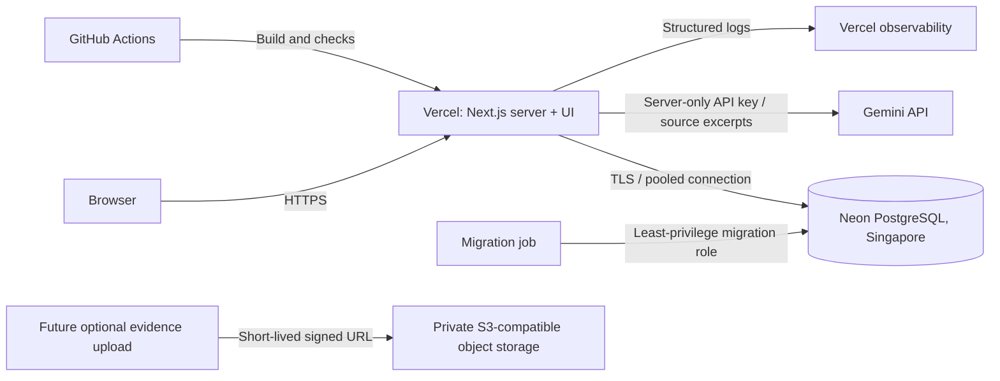

# PilotBridge Technical Architecture

Status: proposed implementation baseline for the MVP defined in `PILOTBRIDGE_MASTERPLAN.md`.

## 1. Decisions

- Build a **modular monolith**: Next.js App Router, React, TypeScript, server actions/route handlers, and PostgreSQL in one deployable application.
- Deploy the application to **Vercel** and use **Neon PostgreSQL in Singapore (`ap-southeast-1`)**. Pin production to the current stable Next.js 16.3.x patch; use the Node.js LTS version supported by that release. Commit the lockfile.
- Use **Drizzle ORM** for typed queries and version-controlled SQL migrations. Use PostgreSQL constraints and transactions for workflow integrity, not client-side checks.
- Use **`@google/genai`** server-side for the required Gemma 4/Gemini API integration. Confirm the exact model identifier available to the hackathon API key before implementation; keep it in `GEMINI_MODEL`, not scattered through code.
- Keep AI output as an isolated draft. A separate reviewed mutation creates or updates domain records.
- No microservices, Kubernetes, Redis, vector database, message queue, background worker, or separate Python service for the MVP. Synchronous AI calls, relational queries, and request-time health calculations are sufficient for one demo POC and five startups.

## 2. Infrastructure and request boundaries



- Production and preview environments receive **separate databases and Gemini API quotas**. Demo reset is a development/preview operation, never a public production endpoint.
- Use the provider's TLS-enabled pooled connection string at runtime and direct connection for migrations. Database credentials and `GEMINI_API_KEY` are encrypted environment secrets; no `NEXT_PUBLIC_` prefix.
- AI calls run in Node.js server handlers, never in the browser. Bound uploaded documents, prompt size, request time, and output tokens. Set a request timeout longer than the AI client timeout so the client timeout fires first.
- Health and dashboard values are computed on read; no cron is required. Optional file storage is deferred until the core workflow works with evidence links.
- Backups: enable Neon point-in-time recovery; test a restore before any non-demo launch. For the hackathon, provide an idempotent seed/reset script as the reproducible recovery path.
- Budget target: stay on current free tiers for the demo. Confirm region, AI quotas, data-processing terms, and spending limits at provisioning; do not assume them from this plan.

## 3. Stack and dependencies

| Concern | Choice | Why / boundary |
|---|---|---|
| Runtime | Node.js LTS, pnpm, TypeScript strict mode | One language and deployment; reproducible installs |
| Web/API | Next.js 16.3.x App Router, React, server components | UI and trusted mutations in one small codebase |
| UI | Tailwind CSS, native accessible HTML; add only proven form/dialog primitives | Fast workflow UI without a large component runtime |
| Validation | Zod, shared at API and AI-draft boundaries | Runtime validation; TypeScript types alone do not validate input |
| Database | PostgreSQL, Drizzle ORM, `drizzle-kit` | Relational integrity and auditable migrations |
| AI | `@google/genai`; `response_mime_type: application/json` and `responseJsonSchema` | Structured multimodal drafting; validate responses again with Zod |
| Forms | React Hook Form only where review/editing complexity justifies it | Local editable drafts; not a substitute for server validation |
| Tests | Vitest, Testing Library, Playwright; PostgreSQL integration tests via Testcontainers or CI service | Deterministic rules, cross-role isolation, complete demo path |
| Quality | ESLint, Prettier, TypeScript, pnpm audit, Dependabot | Repeatable checks and dependency patching |

Do not add Prisma alongside Drizzle, an authentication library for the demo switcher, a state-management library, an embeddings SDK, or a document database. Use pinned, reviewed packages and patch the lockfile when security updates land.

## 4. Application modules

```text
app/                         screens and thin HTTP/action entry points
components/                  workflow UI and editable draft review
src/db/                      schema, migrations, seed, query helpers
src/domain/challenges/       approval and challenge validation
src/domain/matching/         versioned eligibility and criterion scoring
src/domain/pocs/             state machine, partner locks, health, next action
src/domain/outcomes/         result review and metric definitions
src/ai/                      prompts, schemas, Gemini adapter, source references
src/auth/                    demo identity; production Auth.js later
src/security/                authorization, rate limits, audit context
```

Route handlers validate input, establish actor context, then call a domain service. The domain service owns transactions. UI components never write directly to tables. Keep deterministic domain functions free of Gemini imports so they remain unit-testable without network access.

## 5. Database design

Use UUID primary keys, `timestamptz` audit timestamps, ISO country/currency codes, `date` for due dates, `numeric` for measurements and money, and JSONB only for versioned flexible content. Foreign keys use restrictive deletes for historical records. Store money only when both value and currency are present.

### Core tables

| Table | Important fields and constraints |
|---|---|
| `organisations` | `name`, `type`, `country_code`, `sector`, `is_fictional` |
| `users` | `organisation_id`, `name`, `role`; membership is explicit |
| `challenges` | `corporate_org_id`, `status`, `raw_problem`, `approved_requirements jsonb`, `approved_at`, `version`; only approved immutable requirements feed matching |
| `challenge_revisions` | `challenge_id`, `revision_no`, `content jsonb`, `source_document_id`; unique `(challenge_id, revision_no)` |
| `startup_profiles` | `organisation_id` unique, capability/maturity/market JSONB, `capacity`, `availability`, `profile_version` |
| `matches` | `challenge_revision_id`, `startup_profile_id`, `rank`, `criterion_results jsonb`, `matching_rule_version`, `eligible`; unique revision/startup and revision/rank |
| `pocs` | `challenge_id`, `startup_org_id`, `status`, `current_charter_revision_id`, `introduction_accepted_at`, `activated_at`, `timezone`, `last_meaningful_activity_at`, `closed_at`, `closure_reason`, `version`; unique `challenge_id` for one POC per challenge in the MVP; **derive health, do not store it** |
| `charter_revisions` | `poc_id`, `revision_no`, `content jsonb`, `valid_from`, `invalidated_at`; unique POC/revision |
| `charter_approvals` | `charter_revision_id`, `organisation_id`, `approved_by`, `approved_at`; unique revision/organisation; application enforces both distinct parties |
| `milestones` | `poc_id`, `title`, `owner_user_id`, `due_date`, `critical`, `status`, `completed_at` |
| `actions` | `poc_id`, optional `milestone_id`, `title`, `owner_user_id`, `due_date`, `status`, `source`, `completed_at` |
| `readiness_items` | `poc_id`, `code`, `completed`, `note`, `is_gate`; unique `(poc_id, code)` |
| `evidence` | `poc_id`, `type`, nullable `uri` or `storage_key`, `description`, `verification_status`, `submitted_by`, `reviewed_by`, `reviewed_at`; exactly one reference type; private HTTPS or controlled storage references only |
| `results` | `poc_id`, `baseline`, `target`, `actual`, `unit`, `period_start`, `period_end`, `evidence_id`, `testimonial`, `review_status`, `reviewed_by`, `reviewed_at`; one result per POC; valid period, non-null completion measurements, and evidence belonging to the same POC |
| `commercial_outcomes` | `poc_id` unique, `stage`, optional `value`/`currency`, `evidence_id`, `verification_status`, `confirmed_by`, `confirmed_at`; signed stage requires verified evidence |
| `activity_events` | `poc_id`, `actor_user_id`, `event_type`, `occurred_at`, `metadata jsonb`; append-only, no secrets/raw prompts |
| `ai_runs` | `purpose`, `schema_version`, `model`, `prompt_version`, `input_digest`, `status`, `started_at`, `finished_at`, `error_code`; exclude raw confidential prompts and API keys |
| `ai_drafts` | `ai_run_id`, `target_type`, `target_id`, `content jsonb`, `source_refs jsonb`, `review_status`, `reviewed_by`, `reviewed_at`; generated content is not approved domain state |
| `documents` | `organisation_id`, `storage_key`, `original_name`, `detected_mime`, `byte_size`, `sha256`, `scan_status`, `created_by`; metadata only, private file bytes elsewhere |

### Required indexes and access patterns

- `matches(challenge_revision_id, rank)` for the top-three view; filter eligibility in the selection query.
- `pocs(status)`, `pocs(startup_org_id)` with a **partial unique index covering every non-draft/non-closed assigned state** (`Matching` through `ResultSubmitted`) to prevent double-booking during selection, review, and execution.
- `milestones(poc_id, critical, due_date)` and `actions(poc_id, owner_user_id, due_date)` for workspace and health queries; partial indexes on unfinished items if data grows.
- `activity_events(poc_id, occurred_at)` for recent activity and timelines.
- `evidence(poc_id, verification_status)`, `results(review_status)` for outcomes and verification.
- Every production query includes organisation/tenant scope in its predicate; add matching composite indexes when multi-tenant access is introduced.

### Transactions and invariants

1. Challenge approval, match generation, and transition to `Matching` occur only after approved requirements validate.
2. Partner confirmation locks the POC row (`SELECT ... FOR UPDATE`), rechecks current eligibility/availability, records the old partner, invalidates an unapproved charter, and inserts the activity event atomically.
3. Activation requires a valid current revision and approvals from both parties. Partner change removes that revision's validity; prior approvals never carry forward.
4. Reviewed result, completion transition, and audit event are one transaction. Commercial signing requires its own confirmation and evidence; no automatic progression from technical success.
5. Domain transitions use an explicit allowed-transition map and optimistic `version` checks to reject stale submissions. Do not rely on disabled buttons.
6. Use database `enum` or checked status values from the first migration. Add explicit checks for cross-field rules; keep cross-row party rules in transaction services and cover them with integration tests.

### Health and metric semantics

- Resolve `Completed`/`Closed Without POC` from terminal POC/result state first. For active POCs, calculate `Stalled`, then `At Risk`, then `On Track` using one injected current time.
- Convert the current instant to the **POC's configured local timezone**, then compare its local `date` to due dates. A critical decision needs a typed milestone/decision record; do not infer it from notes.
- Meaningful activity is an allow-listed set of execution events, not page views or AI generation. Add `last_meaningful_activity_at` maintained in the same transaction as those events.
- Define introduction acceptance as the partner-confirmation event; count each distinct challenge once even if its partner changes. Conversion = distinct approved challenges with at least one confirmed partner / all distinct approved challenges in the same reporting cohort. Median approval time uses `poc.activated_at - challenge.approved_at`; return `null` for no eligible observations. Store `introduction_accepted_at` on the POC for cohort/reporting queries.
- Dashboard aggregates exclude raw notes, testimonials, evidence URLs, and confidential challenge fields. Count verified commercial outcomes only after evidence review.

## 6. AI and deterministic control

- Prompts receive only the approved fields and relevant source excerpts needed for the requested draft. Treat document text as untrusted data, never as instructions.
- Store prompt version, JSON-schema version, model, and input digest for reproducibility. Return `null` for unsupported fields and source references for claims.
- Validate Gemini output with the matching Zod schema; reject oversized/malformed output. Permit one bounded retry with a corrective prompt, then return a clear failure. Never save a partial AI result.
- AI generation and workflow mutation are separate transactions. An AI timeout cannot change a partner, approve a charter, create actions, or complete a result.
- Ranking uses versioned deterministic criteria and evidence IDs. AI may explain a computed match, but may not choose eligibility or alter the score.

## 7. Security plan

### Demo boundary

The role switcher is allowed only with seeded fictional data. Deploy it behind preview access control, visibly label the environment, and never represent it as authentication. Production identity is a release blocker, not an MVP dependency.

### Production identity and authorization

- Add Auth.js with a managed OIDC provider, secure HTTP-only encrypted sessions, verified email/domain policy, MFA for programme managers, and server-side session checks. Do not build password storage.
- Authorize every mutation and detail query using authenticated user → organisation membership → role → resource ownership. Programme manager access is explicit, not a hidden client role.
- Corporate users manage their challenges and assigned POC actions; startups manage their profile and assigned POC work; programme managers review outcomes. Only the authorised reviewer verifies evidence/results.
- Use origin checks for server actions, CSRF tokens for cookie-based route mutations, `SameSite=Lax` or stricter cookies, `Secure`, and narrow CORS (same-origin by default).

### Data, uploads, and AI exposure

- Parameterised ORM queries, output escaping, no unsanitised HTML rendering, and a restrictive Content Security Policy with `frame-ancestors 'none'`. Add HSTS at HTTPS deployment and standard `nosniff`/referrer permissions headers.
- Limit challenge/notes body sizes and AI calls per authenticated actor and organisation. Enforce request timeouts and bounded output; avoid unbounded concurrency that can exhaust AI quota.
- Allow only validated PDF/image MIME types and a conservative size limit such as 10 MiB initially. Do not execute documents or render raw active content. Future uploads go to private storage with random keys, short-lived signed downloads, malware scanning, and content-disposition attachment. No public buckets.
- Store private evidence links as credentials-free references. Do not expose signed URLs to aggregate views or logs.
- Keep Gemini server-only. Before real corporate data, establish consent, retention, residency, subprocessor terms, and whether prompts are used for training. Redact or omit secrets and unnecessary personal data. Do not put confidential source material in `ai_runs` or activity events.
- Set application log retention to the minimum practical period; redact cookies, authorization headers, raw notes, and document bodies. Audit security-sensitive events with actor, target, timestamp, and outcome.

### Supply chain and secrets

- GitHub branch protection and reviewed pull requests; Dependabot plus lockfile audit in CI. Keep third-party actions commit-pinned for production release workflows.
- Store secrets in Vercel/Neon/GitHub secret managers, not source or client bundles. Separate preview/production credentials and rotate after any suspected exposure.
- Private PostgreSQL access through TLS; runtime role cannot alter schema. Migration role is used only by deployment. Confirm backup/restore and deletion procedures before real data.

## 8. Environments, delivery, and verification

| Environment | Purpose | Data/access |
|---|---|---|
| Local | Development and deterministic tests | Docker PostgreSQL; fictional seed; optional mocked AI adapter for offline workflow work |
| Preview | PR/demo review | Separate Neon branch/database; fictional data; protected preview; limited AI quota |
| Production | Stable demo initially | Separate database/secrets; role switcher removed before real users or data |

CI order: frozen lockfile install → lint/typecheck → unit/integration tests → production build → dependency audit. Run migrations as a controlled deployment step, not from every server instance. Smoke-test migration, login/role context, and the core workflow after deployment.

Minimum acceptance tests:

- Partner locks, eligibility rechecks, stale concurrent updates, and charter revision invalidation.
- Both-party approval and activation; no activation after partner replacement.
- Health precedence and local-date boundaries, including no meaningful activity for exactly 14 days and critical delay over 7 days.
- Required result measurements/evidence and independent commercial signing.
- Conversion denominator, empty median, verified versus self-reported outcomes.
- Malformed AI JSON and provider timeout leave domain state unchanged; missing values remain `null`.
- Cross-organisation read/write attempts fail once production auth exists.
- Playwright runs the full fictional demo and verifies that the dashboard changes after review.

## 9. Build order

1. Bootstrap pinned application, lint/typecheck/test CI, local PostgreSQL, Drizzle migrations, and fictional seed.
2. Implement schema and domain services: challenge approval, matching, partner confirmation, charter approvals, milestones/actions, health, result review, and metrics.
3. Connect the five screens to those services using non-AI fallback content; verify the full loop.
4. Add Gemini adapter, versioned schemas, draft review, timeouts, and redacted run metadata.
5. Add preview/production environments, backup/reset procedures, security headers, rate limits, logging, and end-to-end deployment verification.
6. Only then consider private evidence uploads and PDF export. Do not add integrations excluded by the MVP.

## 10. Post-MVP triggers

- Real users/data → OIDC authentication, organisation-scoped authorization, retention/deletion policy, reviewed regional hosting.
- Long AI/files work → durable job queue and worker with idempotency keys; do not introduce a queue before it is needed.
- Large unstructured startup discovery → evaluate retrieval/embeddings separately; deterministic POC rules stay relational.
- External integrations → scoped OAuth credentials, webhook signature validation, replay protection, and per-integration audit trails.

References: [Next.js 16.3 release](https://nextjs.org/blog/next-16-3), [Google Gen AI structured output types](https://googleapis.github.io/js-genai/release_docs/interfaces/types.GenerateContentConfig.html).
