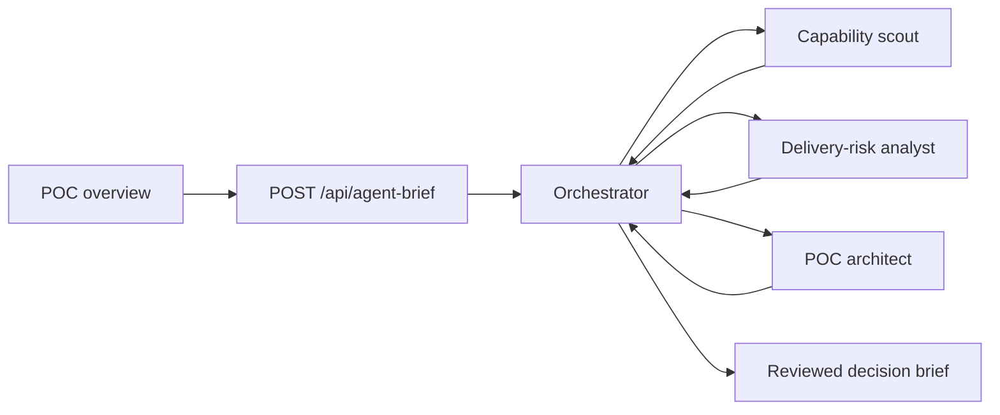

# Multi-agent inference

## Topology

The three specialists run in parallel. The orchestrator receives their bounded JSON outputs and produces conditions, questions, readiness, and a next action.

## Provider

- OpenAI-compatible LiteLLM endpoint
- Model: `deepseek-v4.1-flash`
- `LITELLM_API_KEY`, `LITELLM_BASE_URL`, `LITELLM_MODEL` are server-only
- `.env.local` and `.env.production` are ignored by Git
- Production secret file mode is `600`

## Credential rule

A bearer API key **cannot be “hashed” for authentication**: the provider compares the original secret. Hashing would make every request fail. Protect it with:

1. Server-only environment variables
2. File permissions and secret-manager access control
3. Rotation after exposure
4. Log redaction
5. Per-key spend and rate limits at the provider

The key pasted into chat must be treated as exposed. Rotate it in LiteLLM, update `.env.production`, restart the container, and revoke the old key.

## Failure behavior

- Each agent retries once with a corrective instruction.
- Arrays are bounded to schema limits.
- A failed specialist is omitted and named in the orchestrator input.
- If all agents fail, deterministic profile evidence is returned.
- Agent output is advisory only: eligibility, scores, health, approvals, and commercial state remain deterministic.

## Audit

Every agent records purpose, prompt/schema version, model, SHA-256 input digest, status, attempts, error code, and latency. Raw prompts and API keys are not stored.
