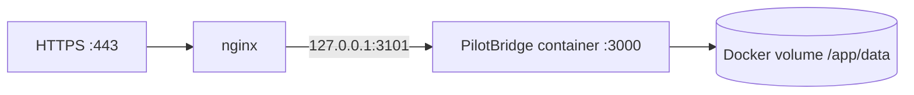

# PilotBridge VPS deployment

Live: **https://pilotbridge.nusabyte.cloud**

## Topology



- Host: `ecta-vps` (`72.62.254.65`), shared with other nginx services
- App directory: `/opt/pilotbridge`
- Container: `pilotbridge`
- Data volume: `pilotbridge_pilotbridge-data`
- nginx site: `/etc/nginx/sites-available/pilotbridge.nusabyte.cloud`
- TLS: Certbot, auto-renewal enabled

## First deployment

```bash
ssh ecta-vps
mkdir -p /opt/pilotbridge
cd /opt/pilotbridge
# copy source (see release command below)
cp .env.production.example .env.production
chmod 600 .env.production
docker compose -f docker-compose.production.yml up -d --build
```

Install nginx site:

```bash
sudo cp deploy/pilotbridge.nusabyte.cloud.conf /etc/nginx/sites-available/pilotbridge.nusabyte.cloud
sudo ln -sfn /etc/nginx/sites-available/pilotbridge.nusabyte.cloud /etc/nginx/sites-enabled/pilotbridge.nusabyte.cloud
sudo nginx -t && sudo systemctl reload nginx
sudo certbot --nginx -d pilotbridge.nusabyte.cloud --redirect
```

## Release update

From the repository root:

```bash
scp -r Dockerfile docker-compose.production.yml package.json pnpm-lock.yaml \
  next.config.ts tsconfig.json next-env.d.ts eslint.config.mjs src public \
  ecta-vps:/opt/pilotbridge/
ssh ecta-vps "cd /opt/pilotbridge && docker compose -f docker-compose.production.yml up -d --build"
```

Never overwrite `/opt/pilotbridge/.env.production` during a release.

## Health and logs

```bash
curl -fsS https://pilotbridge.nusabyte.cloud/api/health
ssh ecta-vps "docker inspect --format '{{.State.Status}} {{.State.Health.Status}}' pilotbridge"
ssh ecta-vps "docker logs --tail 100 pilotbridge"
```

## Persistence and recovery

The SQLite database lives in the Docker volume, not the image. To back it up:

```bash
ssh ecta-vps "docker run --rm -v pilotbridge_pilotbridge-data:/data -v /root:/backup alpine tar czf /backup/pilotbridge-data-\$(date +%F).tgz -C /data ."
```

Reset only fictional demo data by using **Reset demo** in the UI. Do not delete the volume without a verified backup.

## Security boundary

- Container binds only to `127.0.0.1:3101`.
- Secrets stay in `/opt/pilotbridge/.env.production` with mode `600`.
- TLS redirects are enforced by nginx.
- The application remains a fictional demo: it has no production authentication and must not hold confidential corporate data.
